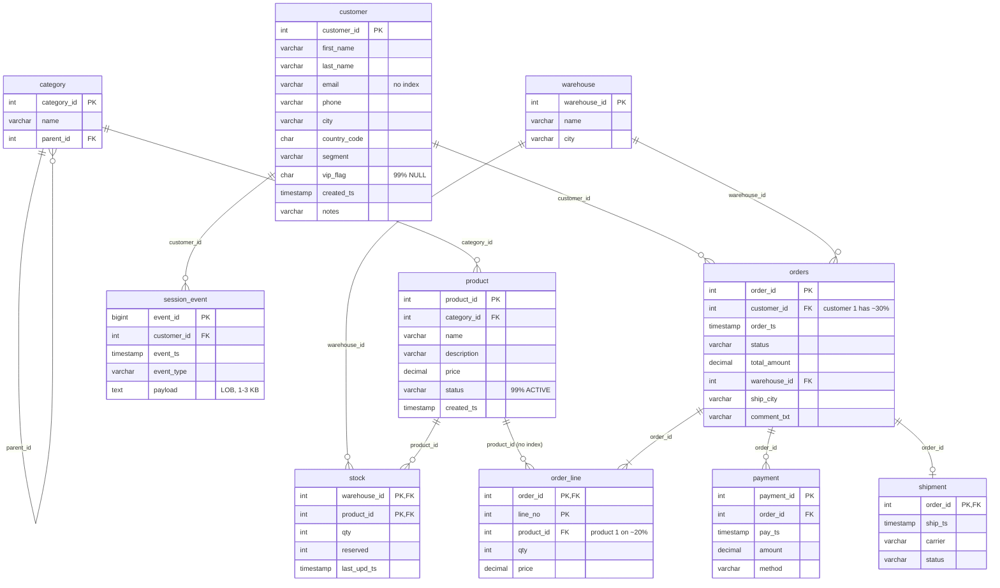
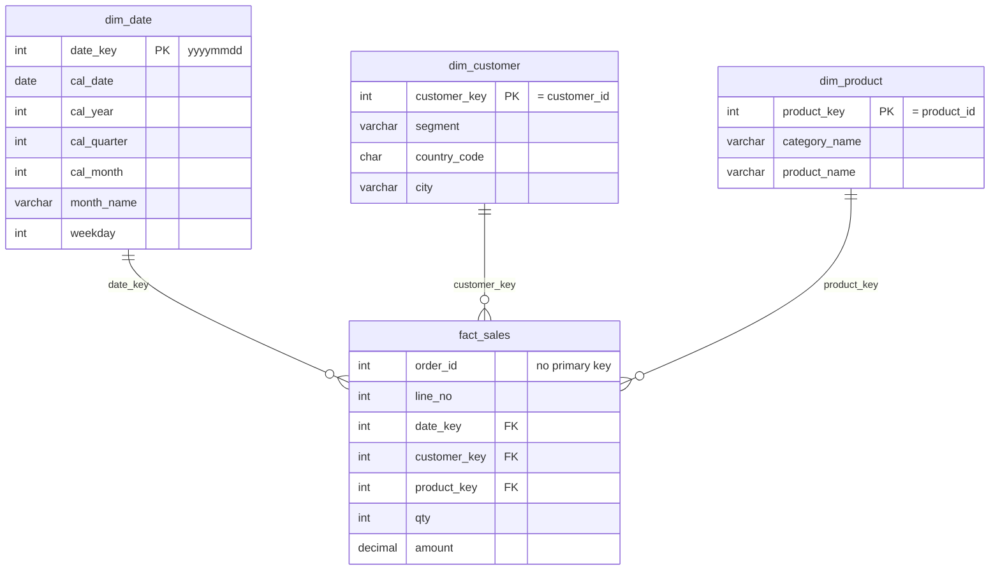

# DbxLoadGen - load generator for test servers

DbxLoadGen puts realistic "dummy traffic" on a test DBMS, so the DbxTune collectors and DbxCentral have something
to show, and so we find bugs. It is our own tool (not HammerDB), so we can add a scenario whenever we want to
test something new.

- **Vendors:** SQL Server, Sybase ASE, Postgres. (MySQL, Oracle and DB2 are planned.)
- **Modes:** `install`, `run`, `status`, `uninstall`, `journal`, `scenarios`.
- **Traffic:** OLTP, OLAP/DW, batch jobs, and **problem scenarios** (blocking, deadlocks, long transactions,
  spills, literal SQL, ...) that should make DbxTune show something or raise an alarm.
- **Journal:** every run writes a JSON Lines file saying what was done, when, by which session, and what
  DbxTune *should* have seen. Put it next to the DbxTune recording of the same time window to find what the
  collectors miss.
- **Safe for cron:** always time limited, gentle by default, its own logins, database and password file.

```
loadgen.sh install   -t sqlserver -S myhost -U sa --size small
loadgen.sh run       -t sqlserver -S myhost --duration 15m-45m --intensity low
loadgen.sh status    -t sqlserver -S myhost
loadgen.sh uninstall -t sqlserver -S myhost -U sa
```

On Windows use `loadgen.bat`. Both call `dbxtune.sh loadgen` / `dbxtune.bat loadgen`.

Contents:
1. [Before you start](#1-before-you-start)
2. [Install](#2-install)
3. [Running it](#3-running-it)
4. [Uninstall](#4-uninstall)
5. [What it does](#5-what-it-does)
6. [How it works](#6-how-it-works)
7. [The deliberate design flaws](#7-the-deliberate-design-flaws)
8. [The scenarios](#8-the-scenarios)
9. [The journal: comparing with DbxTune](#9-the-journal-comparing-with-dbxtune)
10. [Command line reference](#10-command-line-reference)

---

## 1. Before you start

### Connection options (all modes)

| Option | Meaning |
|---|---|
| `-t, --dbms` | `sqlserver`, `ase` or `postgres` |
| `-S, --server` | `host` or `host:port`. Default ports: SQL Server 1433, ASE 5000, Postgres 5432 |
| `--name` | Logical server name: the key in the password file and the journal folder name. Default: `host`, or `host_port` when a port is given (a `:` can't be used in the password file). |
| `-U, --user` | Admin user for install/uninstall/status. Default `sa` (SQL Server, ASE) or `postgres` |
| `-P, --password` | Admin password. Default: taken from the load generator's own password file (below) |
| `-D, --dbname` | Database. Default `dbxt_loadgen` |

There is no `-n` short option on purpose: the DbxTune start scripts treat `-n` as "start a collector without GUI".

### Passwords: the load generator's own password file

The load generator does **not** use DbxTune's `~/.passwd.enc`. It has its own file:

```
~/.dbxtune/loadgen/.loadgen_passwd.enc        (change with --passwd-file)
```

Same encrypted format as `~/.passwd.enc`. It holds:
- the admin password (you add it once), so cron lines never contain a password;
- the passwords of the generated logins `dbxt_user_1..N` (written by `install`, removed by `uninstall`).

Add the admin password (the server name is the `--name` value, e.g. `myhost` or `myhost_14330`):

```bash
dbxPassword.sh set -U sa -S myhost -P secret -f ~/.dbxtune/loadgen/.loadgen_passwd.enc
```

On Windows: `dbxPassword.bat set -U sa -S myhost -P secret -F %USERPROFILE%\.dbxtune\loadgen\.loadgen_passwd.enc`
(the Linux script uses `-f`, the Windows/Java tool `-F`). The file must exist on Windows first (an empty file is fine).

`run` uses the generated logins only. Run it as the same OS user, on the same machine where `install` was done,
because that is where the passwords were written.

### What the DBMS must allow

| DBMS | Needed |
|---|---|
| SQL Server | A `sysadmin` login for install/uninstall. **SQL Server authentication (mixed mode) must be on**: the generated logins are SQL logins. |
| Sybase ASE | `sa_role` + `sso_role` (create logins), and room for the database: see [Sybase ASE: where the database goes](#sybase-ase-where-the-database-goes). jConnect connects with `ENCRYPT_PASSWORD=true`. |
| Postgres | A superuser (or a role with `CREATEDB` + `CREATEROLE`). `pg_hba.conf` must allow password logins for the `dbxt_user_*` roles from the machine the load generator runs on. |

For the DbxTune side it helps (not required):
- Postgres: `pg_stat_statements` loaded, `track_functions = pl` (so the cursor/temp table functions show up in CmPgFunctions).
- SQL Server: Query Store (the install turns it on in a database it creates, SQL Server 2016+).

---

## 2. Install

```bash
loadgen.sh install -t <dbms> -S <host[:port]> [-U admin] [--size small|medium|large|xl|xxl|xxxl] [--logins 10] [--seed 42]
```

What it does, in order:
1. Creates the database (or uses an existing one, see `--use-existing-db`).
2. Creates the logins `dbxt_user_1..N` (default 10) with random passwords, saved in the load generator's password file.
   If a login with that name already exists (for example kept with `uninstall --keep-logins`) it gets a new password instead.
3. Creates the tables, fills them with generated data (same `--seed` = same data), creates the indexes and procedures,
   and updates statistics.
4. Makes the logins users in the database with owner rights (the maintenance scenarios need that).
5. Writes the marker table `dbxt_loadgen_info` (version, size, seed, logins, status). `run` and `uninstall` check it.
6. Writes an install journal, including the list of deliberate design flaws ("the answer key").

### Sizes

| Size | Customers | Products | Orders (~3 lines each) | Rough size (data + indexes) |
|---|---|---|---|---|
| `small` (default) | 20 000 | 2 000 | 200 000 | ~180 MB |
| `medium` | 200 000 | 20 000 | 2 000 000 | ~1.7 GB |
| `large` | 1 000 000 | 100 000 | 10 000 000 | ~8.5 GB |
| `xl` | 4 000 000 | 400 000 | 40 000 000 | ~34 GB |
| `xxl` | 20 000 000 | 2 000 000 | 200 000 000 | ~170 GB |
| `xxxl` | 100 000 000 | 10 000 000 | 1 000 000 000 | ~850 GB |

Plus `audit_log` (100 000 x factor rows), `session_event` (5 000 x factor rows of 1-3 KB) and `fact_sales`
(90% of the order lines). Only `small` has been tested so far.

The estimate is printed before anything is filled. Install times seen for `small` on Docker: Postgres 10 s,
SQL Server 30 s, ASE 3 minutes.

### Database options used

**SQL Server** (database created by the install):
- `CREATE DATABASE` with the `model` defaults (size, file growth).
- Recovery model `SIMPLE`, so the log does not grow without log backups.
- `QUERY_STORE = ON` (skipped, with a log line, before SQL Server 2016).
- Logins: `CHECK_POLICY = OFF`, default database = the load generator database; users are in `db_owner`.

**Sybase ASE** (database created by the install):
- Size: 2 x the size estimate (at least 300 MB) for data, plus a log of half that (at least 200 MB) when there is a separate log device.
  Override with `--ase-db-size-mb`.
- `trunc log on chkpt` and `select into/bulkcopy/pllsort` are turned on.
- Every table is `lock datarows`.
- Logins via `sp_addlogin`; in the database they are aliased to `dbo` (`sp_addalias`), so they can update statistics.

**Postgres** (database created by the install):
- `CREATE DATABASE` with the server defaults.
- The role `dbxt_loadgen_role` (NOLOGIN) owns the schema `dbxt` and every object in it. The logins are members of
  that role, and each login has `search_path = dbxt, public` set on the role (not on the database).

**Existing database (`--use-existing-db`)**: no options are changed. The install prints what it found:
- SQL Server: the recovery model and whether Query Store is on. With `FULL` recovery the log grows unless you take log backups.
- ASE: whether `trunc log on chkpt` is on. If it is off, the log fills up unless you dump it.

### Sybase ASE: where the database goes

`CREATE DATABASE` on ASE needs device space. Pick one:

1. **No option: the load generator creates its own devices next to the existing ones** (the default):
   ```bash
   loadgen.sh install -t ase -S asehost
   ```
   It reads `master..sysdevices` (disk devices with a file; dump devices and raw partitions such as `/dev/...` are skipped):
   - the **data** device goes to the directory that holds most data devices,
   - the **log** device goes to the directory that holds most log devices: a device or file name with `log`, `logs`,
     `xlog`, `tlog` or `wal` as its own word part, optionally followed by `dev`/`device` (`pubs_log_1`, `tlog01`,
     `sales_xlog`, `logdev`; not `syslogs` or `catalog`). No log devices: next to the data device.
   - User devices count first; `master`, `sysprocsdev`, `systemdbdev`, `sybsysdb`, `sybmgmtdev`, `sybsecurity` and
     tempdb devices are only used when there are no others.
   - The file extension is the one most used by those data devices (`.dat`, `.dev`...).

   The choice is printed and written to the journal. If there is **no** file-based device (only raw partitions),
   the install stops before creating anything, lists the devices it found and what to do (options 2-5).
   It runs `disk init` for `dbxt_loadgen_data` and `dbxt_loadgen_log` (file names get a timestamp). `uninstall` drops
   the devices with `sp_dropdevice <name>, dropfile`, so ASE deletes the files too. If that fails (an older ASE),
   it drops only the device and warns that the file is still on the ASE host, with the path to remove by hand.
   It does not check the free space in that directory: `disk init` fails (and the install stops) if it is too small.
2. **Own devices in a directory you choose** (both data and log there): `--ase-device-dir /sybase/devices`.
   The directory is **on the ASE host**.
   (From Git Bash on Windows use `MSYS_NO_PATHCONV=1`, otherwise `/sybase/...` is turned into a Windows path.)
3. **Use devices that already have free space**: `--ase-data-dev <dev> [--ase-log-dev <dev>]`.
4. **Use the default device(s)**: `--ase-data-dev default` (`create database ... on default`). Often too small on a test box.
5. **Create the database yourself** and install into it (next section). Good when the DBA wants control over devices and sizes.

### Installing into a database you created (`--use-existing-db`)

```bash
# you create the database first, then:
loadgen.sh install -t ase -S asehost -D my_test_db --use-existing-db
```

- The database must exist, and must not already have tables/procedures with the load generator names
  (Postgres: must not have a schema `dbxt`). Otherwise the install stops before changing anything.
- Its options are not changed (see above).
- The marker table records `databaseCreated = false`, so **`uninstall` will never drop that database**: it drops only
  the load generator tables and procedures (Postgres: the schema `dbxt`), the database users, and the logins.
- Remember `-D my_test_db` on every later command (`run`, `status`, `uninstall`).

### After an upgrade of the load generator

Tables, indexes and procedures are created at `install` only. When a new version changes them (e.g. 2026-11-07:
`ix_orders_status` on `(status, order_ts)`, `p_rbar_price_adjust` with `@max_rows`, `p_temp_report` that recompiles),
an existing install keeps the old ones until `uninstall` + `install`. `run` still works on an old install
(`rbar_cursor` then calls the procedure without a limit and says so in the journal).

### Getting the logins back (`--logins-only`)

```bash
loadgen.sh install -t sqlserver -S myhost --logins-only
```

Creates (or resets the passwords of) the logins of an existing install, and makes them users in the database again.
Use it after `uninstall --keep-database`, or when the password file was lost. The number of logins comes from the
install info (`-L` overrides).

---

## 3. Running it

```bash
loadgen.sh run -t <dbms> -S <host[:port]> [--duration 15m|15m-45m|1h|90s] [--intensity low|medium|high]
               [--threads N] [--scenarios a,b] [--exclude a,b] [--no-problems] [-c my.properties]
```

### Modes

| Mode | What it does | Rights |
|---|---|---|
| `install` | Logins, database, tables, data (see above) | admin |
| `run` | Runs the workload for the duration, then stops by itself | the `dbxt_user_#` logins |
| `status` | Install info, row counts, the skew, the last 10 runs | admin, else `dbxt_user_1` |
| `uninstall` | Drops the database and/or the logins (see below) | admin |
| `journal` | Prints a journal file in readable form (default: the newest; `--name` for one server, `--file` for a given file) | none |
| `scenarios` | Lists all scenarios with their weight / interval | none |

### Duration

- `15m`, `90s`, `1h`: a fixed time.
- `15m-45m`: a random time in that range (each cron run gets a different length).
- The run **always ends**: at the end the workers stop; anything still running gets 60 more seconds, then a watchdog
  cancels the statements and closes the connections. Ctrl-C / SIGTERM stops the same way.

### Intensity

| Intensity | OLTP threads | OLAP threads | Think time between units of work |
|---|---|---|---|
| `low` (default) | 4 | 1 | 200-1000 ms |
| `medium` | 10 | 2 | 50-500 ms |
| `high` | 25 | 4 | 0-100 ms |

- OLAP threads wait `think x 5 + 2 s` between queries.
- The intensity changes **only** the normal traffic (threads + think time). The **problem scenarios are the same** at
  every intensity (same scenarios, `everyMinutes`, durations; they open their own sessions), and so are the logins:
  all sessions share the `dbxt_user_1..N` pool made at `install` (`-L`), round robin.
- `--threads N` overrides the number of OLTP threads. Every value can be set in a properties file:
  `intensity.<low|medium|high>.oltpThreads`, `.olapThreads`, `.thinkMinMs`, `.thinkMaxMs`.
- Threads start spread over the first minute (ramp-up).
- Runs of 15 minutes or more get one busier 5 minute **wave** at a random time (think time x 0.3), so the graphs are not flat.
- Numbers seen on Docker (`small`): low about 4 units of work/s, medium about 30/s.
- Seen on a 2-core SQL Server 2025 VM, size `large`, 30 minutes (2026-11-07): `low` ~7 800 units of work, DbxTune
  samples median 1.6 s (max 9 s); `medium` ~14 900 units, CPU at ~100%, samples median 11.6 s (max 37 s, so ~60 s
  between samples). The CPU then goes to the deliberate flaws (`stock_check` scans `stock`) and the OLAP queries.
  On small test servers use `low`, or expect slow samples.

### How a run uses its time (scheduling)

A run does **not** go through the scenarios in order (#1, #2, #3, then start over), and `--duration` is **not**
divided between them. The duration only says when the run stops. Two things run side by side for the whole time:

**1. Worker threads: random pick by weight (OLTP, OLAP, BATCH)**
- The OLTP threads pick from the OLTP scenarios; the OLAP threads pick from the OLAP **and** BATCH scenarios.
- Each thread loops: pick a scenario at random by weight -> run it -> wait the think time -> pick again, until the run ends.
- A weight is a share: in the OLTP pool `new_order` (30) is picked about 30 % of the time, `delivery` (5) about 5 %
  (the default OLTP weights add up to 95). So the **mix is the same** for a 5 minute and a 45 minute run; a longer run
  just does more of it.
- Each run is different (the run is not seeded; `--seed` only applies to the data at `install`).

**2. Problem scheduler: on a clock, every N minutes**
- Each problem scenario has `everyMinutes`. Its first start is at a **random time within its first interval** (after the
  ramp-up), then every N minutes after that. So the problems don't all fire at the same time, and a cron run every day
  gets them at different times.
- A problem runs in its own thread with its own connections, **next to** the normal traffic.
- It is skipped when the same problem is still running from last time, and nothing new starts in the last 30 seconds.
  A problem that is still running at the end of the run is cut short (the journal has its real start/end).
- How long a problem lasts: see [Problems run a bit longer than the setting](#problem-scenarios-each-runs-every-n-minutes).

**3. Shape over time**
- **Ramp-up**: the threads start one by one over the first `min(60 s, duration / 5)`.
- **Wave** (runs of 15 minutes or more): one busier 5 minute period at a random time, think time x 0.3.
- **End**: workers stop at the end of the duration; anything still running gets 60 more seconds, then the watchdog
  cancels it.

**What that means for different `--duration` values** (default settings):

| `--duration` | OLTP/OLAP traffic | Problems |
|---|---|---|
| `1m`-`5m` | Ramp-up is 12-60 s, then the normal mix. No wave. | **Few or none**: a problem every 10 min has its first start anywhere in 1:00-11:00, so it is often after the end. Use `--scenarios` + a low `everyMinutes` to test one problem (see below). |
| `15m` | Normal mix, one wave. | Every problem with `everyMinutes` up to ~13 fires at least once; the ones every 4-7 min fire 2-4 times. `long_tran` (every 15) fires in most runs, but not all. |
| `15m-45m` (cron) | Normal mix, one wave at a random time. | Each problem fires about `duration / everyMinutes` times (e.g. 30 min: `n_plus_one` ~6, `blocking` ~3, `long_tran` 1-2), at different times every day. |
| `1h` and longer | Normal mix, still **one** wave. | Every problem fires about `60 / everyMinutes` times. |

**What you can change** (on the command line, or in a properties file: `-c my.properties`,
`~/.dbxtune/loadgen/loadgen.properties`, `${DBXTUNE_HOME}/conf/loadgen.properties`):

| You want | Setting |
|---|---|
| more or less load | `--intensity low\|medium\|high`, `--threads N` (OLTP threads), `intensity.<level>.oltpThreads` / `olapThreads` / `thinkMinMs` / `thinkMaxMs` |
| a different mix | `scenario.<name>.weight=N` (`0` = never) |
| only some scenarios | `--scenarios a,b`, `--exclude a,b`, `scenario.<name>.enabled=false` |
| problems more or less often | `scenario.<name>.everyMinutes=N` (`0` = never), `--no-problems` |
| problems longer/shorter | `scenario.<name>.holdSeconds` / `durationSeconds`, `problem.extraSeconds` |
| test one problem in a short run | e.g. `--duration 5m --scenarios new_order,blocking` with `scenario.blocking.everyMinutes=1` in a `-c` file: it starts within the first ~2 minutes and then again every minute (when the last one is done) |

Fixed today (no setting): the ramp-up time, the wave (one, 5 minutes, x 0.3, only for runs of 15 minutes or more),
the OLAP think time (`think x 5 + 2 s`), the 30 second "no new problem" window at the end, and the random first start
of the problems.

### Choosing scenarios

- `--scenarios new_order,payment,blocking` runs only those.
- `--exclude rbar_cursor,conn_churn` skips those.
- `--no-problems` runs no problem scenarios (only "clean" traffic).
- In a properties file (`-c`, or `~/.dbxtune/loadgen/loadgen.properties`, or `${DBXTUNE_HOME}/conf/loadgen.properties`):
  ```properties
  scenario.blocking.enabled=false
  scenario.new_order.weight=50
  scenario.deadlock.everyMinutes=3
  scenario.blocking.holdSeconds=180
  intensity.low.oltpThreads=6
  ```
  `conf/loadgen.properties` lists every setting with its default.

### Cron examples

```cron
# Every day 02:10: 15-45 minutes of gentle traffic on three servers (one after another)
10 1 * * * /opt/dbxtune/0/bin/loadgen.sh run -t sqlserver -S sqlhost      --duration 15m-45m --intensity low    >> /tmp/loadgen_sqlhost.out 2>&1
10 2 * * * /opt/dbxtune/0/bin/loadgen.sh run -t ase       -S asehost:5000 --duration 15m-45m --intensity low    >> /tmp/loadgen_asehost.out 2>&1
10 3 * * * /opt/dbxtune/0/bin/loadgen.sh run -t postgres  -S pghost       --duration 30m     --intensity medium >> /tmp/loadgen_pghost.out  2>&1
```

Avoid 04:00-06:00 if DbxCentral runs its nightly H2 compaction then.

### Output

- A summary per scenario at the end (count, errors, avg/p95/max ms, the last error), on stdout and in the log.
- Log file: `~/.dbxtune/log/DbxLoadGen.<name>.log`.
- Journal: `~/.dbxtune/loadgen/journal/<name>/<time>_run_<runId>.jsonl` (removed after `--journal-keep-days`, default 30).
- The run is also saved in the table `dbxt_loadgen_runlog` (`status` shows the last 10).
- Exit code: `0` OK (also when single statements failed), `1` usage error, `2` not installed / can't connect /
  already installed, `3` failed.

---

## 4. Uninstall

```bash
loadgen.sh uninstall -t <dbms> -S <host[:port]> [-U admin] [--keep-database | --keep-logins] [--force]
```

| Command | Drops | Keeps |
|---|---|---|
| `uninstall` | the database (or, if it was a `--use-existing-db` install, only our tables/procedures/schema), the database users, the logins, their passwords in the password file, ASE devices the load generator made (`dbxt_loadgen_data`, `dbxt_loadgen_log`) | a database we did not create |
| `uninstall --keep-database` | the logins (and their users/aliases in the database, and their passwords) | the database with all data. `run` refuses until `install --logins-only` |
| `uninstall --keep-logins` | the database / our objects | the logins and their passwords (SQL Server/ASE: default database set to `master`). A later `install` reuses them |
| `uninstall --force` | also without the marker table: logins named `dbxt_user_<number>`, and the database only if it is named `dbxt_loadgen` | anything else |

Safety rules:
- Without `--force`, nothing is dropped unless the database has the marker table `dbxt_loadgen_info`.
- Only logins named `dbxt_user_<number>` are ever dropped.
- A database that the load generator did not create is never dropped.
- A second `uninstall` says there is nothing to uninstall (exit code 2).
- ASE: the device files are deleted with `sp_dropdevice ..., dropfile`; if ASE can't do that, a warning gives the paths to remove by hand on the ASE host.
- Sessions of the load generator logins are killed before their database/logins are dropped.

---

## 5. What it does

A small web shop, used in two ways:

**OLTP "shop"** - `customer`, `product`, `category`, `warehouse`, `stock`, `orders`, `order_line`, `payment`,
`shipment`, `audit_log` (append only), `counter_table` (next-id counters), `session_event` (wide rows with a LOB).

**DW star schema** - `dim_date`, `dim_customer`, `dim_product`, `fact_sales` (loaded from the OLTP tables by an ETL scenario).

### The tables (ER diagrams)

There are **no foreign key constraints** in the database; the lines below are the logical relations the workload
joins on. `PK` = primary key, `FK` = logical foreign key (no constraint). Types are shown as on Postgres
(`text` is `varchar(max)` on SQL Server and `text` on ASE).

**OLTP "shop"**



**DW star schema** (`fact_sales` is filled from `orders` + `order_line` by `etl_fact_sales`)



**Tables without relations**

| Table | What it is |
|---|---|
| `audit_log` | Append only, **no primary key** (`log_ts`, `login_name`, `action`, `object_id`, `details`); purged by `purge_audit`. |
| `counter_table` | One row per counter (`name` PK, `next_val`): the next order/payment/event id. Every new order updates the same row (hot spot). |
| `etl_watermark` | The last `order_id` loaded into `fact_sales`. |
| `dbxt_loadgen_info` | The install marker (`k`, `v`): version, size, seed, install time, logins. `uninstall` refuses without it. |
| `dbxt_loadgen_runlog` | One row per run: start/end, intensity, threads, executions, errors, summary (`status` shows the last 10). |

The indexes (and the duplicate/overlapping/unused ones on purpose) are in [section 7](#7-the-deliberate-design-flaws).

The data is skewed on purpose: customer 1 owns ~30% of all orders, product 1 is on ~20% of the order lines,
~99% of the products are `ACTIVE`, ~99% of `customer.vip_flag` is NULL. Orders are spread over the last 730 days,
and the order id grows with the order time.

On this data the load generator runs:
- **OLTP**: short transactions (new orders, payments, lookups) - most of the load.
- **OLAP**: star joins, top-N, window functions, a report straight on the OLTP tables, and an ETL load.
- **BATCH**: a big purge, statistics updates, a bulk load.
- **PROBLEMS**: every N minutes something that a DBA would want to be told about.

---

## 6. How it works

- **Java**, in the DbxTune code base (`com.dbxtune.loadgen`). It uses the JDBC drivers and the connection code
  (`DbxConnection`) DbxTune already has. The install SQL is in `loadgen/sql/<vendor>_tables.sql` and `<vendor>_indexes.sql`;
  the workload SQL is written in each scenario class (`loadgen/scenario/*.java`), with the vendor differences in-line.
- **Workers**: OLTP and OLAP threads each keep one connection, as `dbxt_user_N` (the logins are used round robin).
  Each picks the next scenario by weight, runs it, and waits the think time. A lost connection is reconnected after 5 s,
  so a server restart does not end the run.
- **Problem scheduler**: each problem scenario runs every N minutes, starting at a random offset in its first interval.
  It opens its own connections and runs in its own thread. The same problem never runs twice at the same time,
  and nothing new starts in the last 30 seconds.
- **Names you see in DbxTune**:
  - login: `dbxt_user_1..N`;
  - program/application name: `dbxt-loadgen:oltp`, `dbxt-loadgen:olap`, or `dbxt-loadgen:<problem>` (e.g. `dbxt-loadgen:blocking`);
  - every statement has a comment `/* dbxt:<scenario> */` right after its first word (`select /* dbxt:payment */ ...`),
    so the scenario is visible in the SQL text (the program name can't change per scenario on a connection).
    Not first in the text: SQL Server keeps only the statement in `dm_exec_query_stats` / Query Store, which starts
    after a leading comment. Exceptions: procedure calls (`{call p_...}`), and the id allocation, which is tagged
    `/* dbxt:next_val */`.
- **The current operation** is also set in a session field that every monitor can see, so a DbxTune row
  (active statement, blocking, open transaction...) tells which scenario, and for problems which role, the session has
  right now. It is set when the scenario changes (one extra short round trip, not counted in the statistics):

  | DBMS | How | Where you see it | Value |
  |---|---|---|---|
  | SQL Server | `set context_info 0x...` | `sys.dm_exec_sessions` / `sys.dm_exec_requests` `.context_info`; SqlServerTune column `context_info_str` (CmActiveStatements, CmWho, CmSessions...) | `dbxt:new_order`, `dbxt:blocking:holder` |
  | ASE | `set clientname '...'` (max 30 chars) | `sysprocesses.clientname`, `monProcessLookup.ClientName`; AseTune column `ClientName` (CmActiveStatements, CmProcessActivity) | `dbxt:new_order`, `dbxt:blocking:waiter` |
  | Postgres | `set application_name = '...'` (max 63 chars) | `pg_stat_activity.application_name`; PostgresTune CmActiveStatements | `dbxt-loadgen:oltp:new_order`, `dbxt-loadgen:blocking:holder` |

  Problem sessions get the role after the scenario: `holder`/`waiter` (blocking), `A_1_then_2` (deadlock),
  `open_transaction` (long_tran)... The journal's `problem` events have the exact value per session (`operation`),
  so it can be matched with what DbxTune recorded. Install/uninstall don't set it.

  For the vendors that come later (checked, not built yet):

  | DBMS | Field (visible to a monitor) | How to set it |
  |---|---|---|
  | Oracle | `V$SESSION.MODULE` / `ACTION` / `CLIENT_INFO` (OracleTune shows them in CmActiveStatements, CmSessions) | JDBC `conn.setClientInfo("OCSID.MODULE"/"OCSID.ACTION", ...)` (sent with the next call, no extra round trip), or `DBMS_APPLICATION_INFO.SET_MODULE` / `SET_ACTION` / `SET_CLIENT_INFO` |
  | DB2 LUW | `CLIENT_APPLNAME`, `CLIENT_ACCTNG`, `CLIENT_USERID`, `CLIENT_WRKSTNNAME` in `MON_GET_CONNECTION` (Db2Tune CmMonGetConnection, CmActiveStatements) | JDBC `conn.setClientInfo("ApplicationName"/"ClientAccountingInformation", ...)` (sent with the next statement), or `call SYSPROC.WLM_SET_CLIENT_INFO(...)` |
  | MySQL | No field that can be changed after login and is shown in the process list. `program_name` (`performance_schema.session_connect_attrs`) is fixed at connect. A user variable (`set @dbxt_op = '...'`) is visible in `performance_schema.user_variables_by_thread` (8.0+, needs SELECT on performance_schema); MySqlTune doesn't read that table today. The `/* dbxt:<scenario> */` SQL comment (in `PROCESSLIST_INFO`) is the practical way. | `set @dbxt_op = '...'` |
- **Ids**: new orders/payments get their id from `counter_table` in a short transaction of their own.
- **Statement timeouts**: 60 s for OLTP, 600 s for OLAP/batch.
- **Journal + statistics**: every statement is timed and counted per scenario and minute; see [section 9](#9-the-journal-comparing-with-dbxtune).

---

## 7. The deliberate design flaws

The install journal lists these as `object` events with a `flaw` text (the "answer key", e.g. for Index Analysis):

| Object | Flaw | Who hits it |
|---|---|---|
| `stock` | Primary key `(warehouse_id, product_id)`: lookups by product only scan the table | stock_check, rbar_cursor |
| `order_line` | No index on `product_id` (a foreign key column) | stock_check, order_report |
| `customer` | No index on `email` | customer_search, non_sargable |
| `audit_log` | Heap, no primary key, append only, big deletes | new_order, payment, purge_audit, long_tran |
| `counter_table` | One row per counter that every transaction updates | all inserts, hot_spot |
| `fact_sales` | Heap without a primary key | etl_fact_sales, the OLAP queries |
| `ix_orders_cust_dup` | Exact duplicate of `ix_orders_cust` | Index Analysis |
| `ix_orders_cust_ts` | Overlapping: `ix_orders_cust` is its left prefix | Index Analysis |
| `ix_orders_ship_city` | Never used by the workload | Index Analysis (unused index) |
| `ix_customer_phone` | VARCHAR column searched with NVARCHAR (SQL Server) / a cast (Postgres) / a function (ASE) | non_sargable |
| `ix_customer_vip` | 99% NULL | - |
| `ix_product_status` | 99% the same value | - |
| `p_order_status` | Parameter sniffing: customer 1 has ~30% of the orders, everyone else a few | order_status |
| `p_rbar_price_adjust` | Row by row with a cursor, plus a `stock` scan per row (at most `@max_rows` rows) | rbar_cursor |
| `p_temp_report` | A select on a temp table, then an index on it, then the same select again (SQL Server/ASE: a recompile; Postgres: catalog churn) | temp_recompile |

Over time the data also drifts on purpose: `bulk_events` adds rows without updating statistics (stale statistics),
`purge_audit` deletes in big chunks, and `fact_sales` grows with the ETL.

---

## 8. The scenarios

`loadgen.sh scenarios` prints this list with the current defaults.

### OLTP (run by the OLTP threads, picked by weight)

| Scenario | Weight | What it does |
|---|---|---|
| `new_order` | 30 | One transaction: insert an order with 1-5 lines, read each price, update stock (products in id order, so these never deadlock each other), update the total, insert an audit row; every 20th also inserts a ~2 KB `session_event` (LOB). 5% of orders are for customer 1, 20% of lines are product 1. |
| `payment` | 20 | Pay one of the newest orders: `NEW -> PAID`, insert payment + audit row. |
| `order_status` | 20 | A customer's order history: half through the procedure `p_order_status` (parameter sniffing), half with plain SQL (top 10 orders + the lines of the newest). |
| `stock_check` | 10 | Stock for a product in all warehouses (a scan: the PK starts with warehouse_id); every 5th also the sold quantity of the product (a scan of `order_line`). |
| `customer_search` | 10 | 70%: last name prefix search (index); 30%: e-mail lookup (no index: a scan). |
| `delivery` | 5 | Ship the 10 oldest PAID orders, one transaction per order (`PAID -> SHIPPED` + shipment row); every 10th run refills low stock in a warehouse. |

### OLAP and BATCH (run by the OLAP threads, picked by weight)

| Scenario | Kind | Weight | What it does |
|---|---|---|---|
| `sales_by_month` | OLAP | 30 | Star join `fact_sales` x `dim_date` x `dim_product` for one year, grouped per month and category. |
| `top_customers` | OLAP | 25 | Top 20 customers by amount in a random 90 day window (`count(distinct)`, order by the sum). |
| `rolling_window` | OLAP | 20 | Daily sales with a 7 day moving average for one quarter. SQL Server/Postgres: a window function; ASE (no window functions): a correlated subquery. |
| `order_report` | OLAP | 15 | Reporting on the OLTP tables (mixed workload): last 30 days per status and warehouse, and the 10 best selling products. |
| `etl_fact_sales` | OLAP | 10 | Loads orders above the watermark into `fact_sales` (insert-select of up to 5000 orders), moves the watermark in the same transaction. |
| `purge_audit` | BATCH | 3 | Deletes the oldest 30 days of `audit_log` in ONE statement (big transaction, log growth). Keeps at least one year. |
| `update_stats` | BATCH | 2 | Updates statistics on one busy table (`update statistics` / `analyze`). |
| `bulk_events` | BATCH | 3 | Inserts 500 `session_event` rows in one transaction, no statistics update (stale statistics over time). |

### PROBLEM scenarios (each runs every N minutes)

For each one the journal has a `problem` event with the sessions involved, the SQL, the result, and an **expected**
block (which CMs and alarms should show it). The expected lists are hints for the comparison, not promises.

**Problems run a bit longer than the setting.** Every `holdSeconds` / `durationSeconds` gets `problem.extraSeconds`
(default 35 = one more DbxTune sample of 30 s + ~5 s to take it) plus 0-9 s random on top. So a problem never stops at
a round number, and it is still active in the sample after the one that first saw it. The times below include this
(60 s -> ~100 s, 120 s -> ~160 s, 300 s -> ~340 s); the journal has the real value. `problem.extraSeconds=0` turns it off.

#### `blocking` - every 10 min
A holder updates one `stock` row and keeps the transaction open, **idle**, for `holdSeconds` (default 120, ~160 s with the extra time);
3 waiters (`waiters`) try to update the same row and wait. OLTP statements that scan `stock` or touch the same row
also wait, so the real chain is longer than the 3 waiters.
- SQL Server: CmActiveStatements, CmWaitingTasks, CmSummary, CmWho; `AlarmEventBlockingLockAlarm` (60 s by default),
  `AlarmEventHoldingLocksWhileWaitForClientInput` (180 s by default, so not with the default ~160 s).
- ASE: CmBlocking, CmActiveStatements, CmSummary, CmLocks; `AlarmEventBlockingLockAlarm`.
- Postgres: CmPgBlockingLocks, CmActiveStatements, CmPgLocks, CmSummary; the holder is `idle in transaction`.
- With 30 s samples, a hold under ~90 s can be over before the alarm threshold is seen; keep `holdSeconds` at 120 or more.

#### `deadlock` - every 7 min
Session A updates stock row 1 then row 2; session B updates row 2 then row 1. One of them is the deadlock victim
(SQL Server/ASE error 1205, Postgres SQLState 40P01). The journal says which spid was the victim.
- SQL Server: CmSummary, CmPerfCounters; `AlarmEventDeadlock`.
- ASE: CmDeadlock, CmSummary, CmSysmon (no deadlock alarm known).
- Postgres: CmPgDatabase `deadlocks` (no deadlock alarm known).

#### `long_tran` - every 15 min
Inserts one `audit_log` row and keeps the transaction open, idle, for `holdSeconds` (default 300, ~340 s with the extra time; skipped when less
than 60 s of the run is left). The log can't be truncated past it.
- SQL Server: CmOpenTransactions, CmDatabases, CmSummary; `AlarmEventLongRunningTransaction` (60 s), holding locks while waiting for client (180 s).
- ASE: CmOpenDatabases, CmSummary; `AlarmEventLongRunningTransaction` (60 s).
- Postgres: CmActiveStatements, CmPgActivity; the open transaction alarm defaults to 30 minutes, so none is expected.

#### `sort_spill` - every 10 min
A big `DISTINCT` over `orders x order_line` with too little memory:
SQL Server `option (max_grant_percent = 0)`, Postgres `set local work_mem = '64kB'`, ASE a work table in tempdb.
- SQL Server: CmTempdbUsage, CmTempdbSpidUsage, CmMemoryGrants, CmExecQueryStats.
- ASE: CmTempdbActivity, CmActiveStatements, CmSqlStatement.
- Postgres: CmPgDatabase `temp_files/temp_bytes`, CmPgStatements `temp_blks_written`.

#### `literal_sql` - every 6 min, ~100 s
About 20 statements per second with literals instead of parameters (joins, so SQL Server can't auto-parameterize them).
- SQL Server: CmPlanCacheHistory, CmPerfCounters (compilations/sec), CmExecQueryStats, CmMemoryClerks.
- ASE: CmStatementCache, CmStmntCacheDetails, CmSqlStatement (unless `enable literal autoparam` is on).
- Postgres: CmPgStatements shows ONE normalized entry with a high call count.

#### `non_sargable` - every 4 min, ~100 s
Two queries per second whose predicate can't use an index:
`phone = N'...'` on a VARCHAR column (SQL Server, implicit conversion), `substring(phone,...)` (ASE), `cast(phone as bigint)` (Postgres);
`upper(last_name) = ?`; `year(order_ts) = ?`; `email like '%...'` (leading wildcard).
- SQL Server: CmExecQueryStats, CmIndexMissing, CmIndexUsage. ASE: CmSqlStatement, CmObjectActivity. Postgres: CmPgStatements, CmPgTables (`seq_scan`).

#### `hot_spot` - every 12 min, ~100 s
6 sessions (`sessions`) increment the same `counter_table` row in a loop, each holding the lock ~20 ms:
many short lock waits on one row. The journal has the number of updates and how many waited over 10 ms.
- SQL Server: CmWaitStats (LCK_M_*), CmWaitingTasks. ASE: CmSpidWait, CmSysWaits, CmLocks. Postgres: CmPgPidWait, CmPgLocks.

#### `rbar_cursor` - every 10 min
Calls `p_rbar_price_adjust` for one category: a cursor over its products, and per product an update of the product
and of its stock rows (a scan, no index on `stock.product_id`). One long call with a very high statement count inside.
Each row scans `stock`, so the rows are limited to `maxRows` = 20 000 000 / stock rows (10-500): about 20 million stock
rows read per call at any size (without a limit one call ran 15 minutes at size `large`). Setting `scenario.rbar_cursor.maxRows`.
- SQL Server: CmExecProcedureStats, CmExecQueryStats, CmExecCursors. ASE: CmActiveStatements, CmProcCallStack, CmCachedProcs.
  Postgres: CmPgFunctions (needs `track_functions`), CmPgStatements.

#### `n_plus_one` - every 5 min, ~100 s
An "ORM style" page: the orders of a customer, then one query per order for its lines, then one query per line for
the product name. Very many tiny statements from one session.
- SQL Server: CmExecQueryStats, CmPerfCounters (batch requests/sec). ASE: CmSqlStatement, CmStmntCacheDetails. Postgres: CmPgStatements.

#### `temp_recompile` - every 8 min, ~100 s
Calls `p_temp_report` twice a second: it fills a temp table, runs a select on it, creates an index on it, and runs the
same select again. The schema changed since the select was compiled, so SQL Server and ASE recompile it
(SQL Server 2022: 2 re-compilations per call; the earlier version, index before the first select, gave none).
- SQL Server: CmPerfCounters (re-compilations/sec), CmExecProcedureStats. ASE: CmSysmon, CmCachedProcs.
  Postgres: temp table create/drop on every call (catalog churn).

#### `conn_churn` - every 10 min, ~100 s
Connect, one query, disconnect - about 4 times a second (an application without a connection pool). Each connection
is also a `session` event in the journal.
- SQL Server: CmPerfCounters (logins/sec). ASE: CmSummary, CmSysmon. Postgres: CmSummary, CmPgActivity.

#### `errors` - every 5 min, ~100 s
A round of failing statements every ~4 s: duplicate key, divide by zero, a query timeout (2 s timeout on a 5 s wait), a missing table.
The journal has the error codes of the first round.
- SQL Server: client errors are not in the error log - check what SqlServerTune shows at all.
- ASE: CmSqlStatement (errors per statement); `AlarmEventClientErrorMsg`.
- Postgres: CmPgDatabase `xact_rollback`; the server log only if `log_min_error_statement` allows it.

Settings for each problem (`scenario.<name>.<setting>`): `everyMinutes`, and where it applies `holdSeconds`,
`waiters`, `sessions`, `durationSeconds` (+ `problem.extraSeconds`, see above). See `conf/loadgen.properties`.

---

## 9. The journal: comparing with DbxTune

One file per run (and per install/uninstall): `~/.dbxtune/loadgen/journal/<name>/<yyyy-MM-dd_HHmmss>_<kind>_<id>.jsonl`.
One JSON object per line; all times are local time with the offset (`2026-11-06T21:30:44.123+01:00`).

| `type` | Content |
|---|---|
| `header` | Run parameters: server, DBMS version, size, intensity, threads, weights, problem intervals, planned end, wave |
| `session` | `connect` / `disconnect` of every connection: login, program name, **the server's session id** (spid / pid) |
| `sql` | The text of each statement once (literals replaced by `?`), with a hash (`sqlHash`) |
| `minute` | Per minute and scenario + statement: count, errors, avg/max ms, rows, the session ids, error codes |
| `problem` | One per problem event: start/end, the sessions and their role (holder, waiter, victim...), details, and the `expected` block |
| `object` | Install/uninstall: created/dropped objects, with the `flaw` text |
| `info` / `error` | Free text (for example "watchdog closed 2 sessions") |
| `summary` | The end totals per scenario |

Print it readable: `loadgen.sh journal --name myhost` (the newest file) or `--file <path>`.

How to compare: take the time window from the header, open the DbxTune recording (or DbxCentral) for the same window,
and for each `problem` event check its `expected` CMs and alarms. The session ids join the two: the journal's
`"spid": 54, "role": "holder"` is the `spid=54` in the collector's blocking alarm. The first comparison
(SQL Server, 2026-11-06) found: blocking and long transaction alarms OK, **but no `AlarmEventDeadlock` for 5 real deadlocks**.

A `compare` mode that reads the DbxCentral REST API and writes an "expected vs seen" report is planned.

---

## 10. Command line reference

```
loadgen <mode> [options]

modes: install | run | status | uninstall | journal | scenarios

connection:
  -t,--dbms <sqlserver|ase|postgres>    -S,--server <host[:port]>    --name <name>
  -U,--user <admin>    -P,--password <pw>    -D,--dbname <db>    --passwd-file <file>    -c,--config <file>

install:
  -s,--size <small|medium|large|xl|xxl|xxxl>    -L,--logins <n>    --seed <n>
  --use-existing-db    --logins-only
  --ase-device-dir <dir>    --ase-data-dev <dev>    --ase-log-dev <dev>    --ase-db-size-mb <mb>

run:
  -d,--duration <15m|15m-45m|1h|90s>    -i,--intensity <low|medium|high>    -T,--threads <n>
  --scenarios <a,b>    --exclude <a,b>    --no-problems    --journal-keep-days <n>

uninstall:
  --keep-database    --keep-logins    --force

journal:
  --file <file>    (or --name <name> for the newest of one server)

  -x,--debug    -h,--help
```
